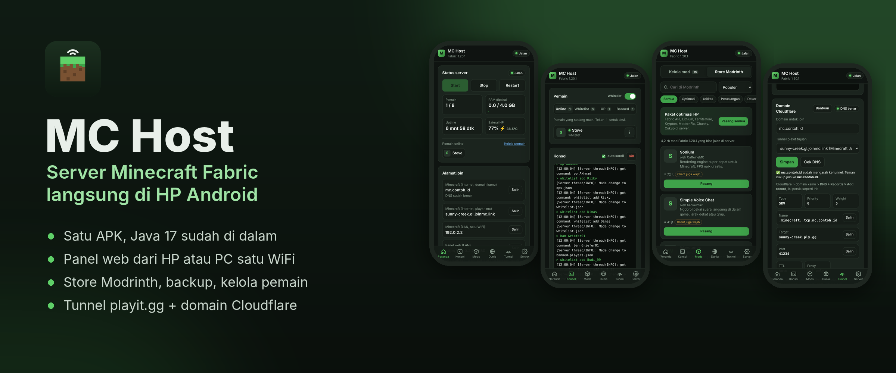
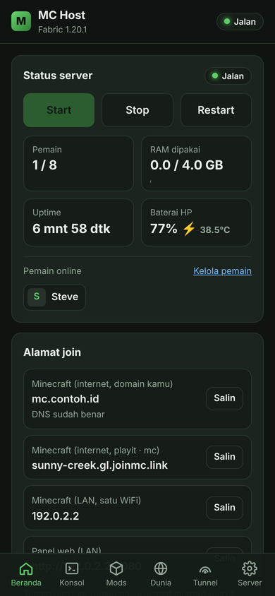
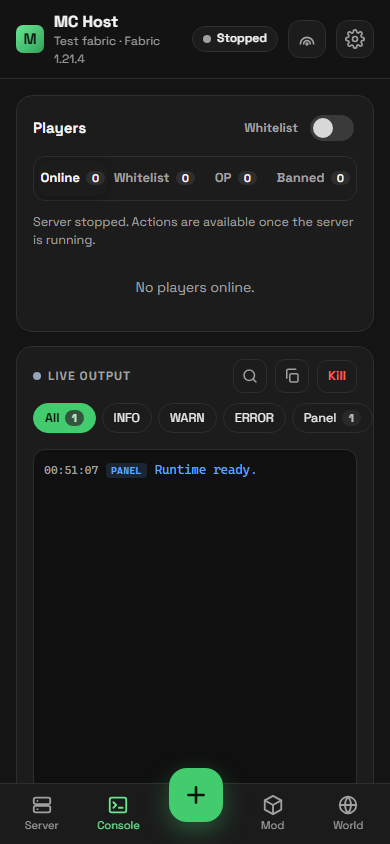
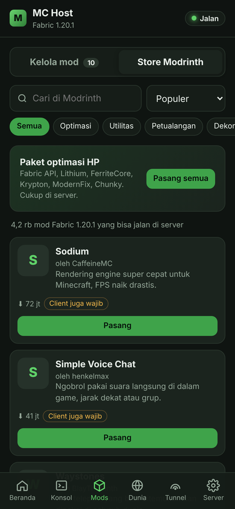
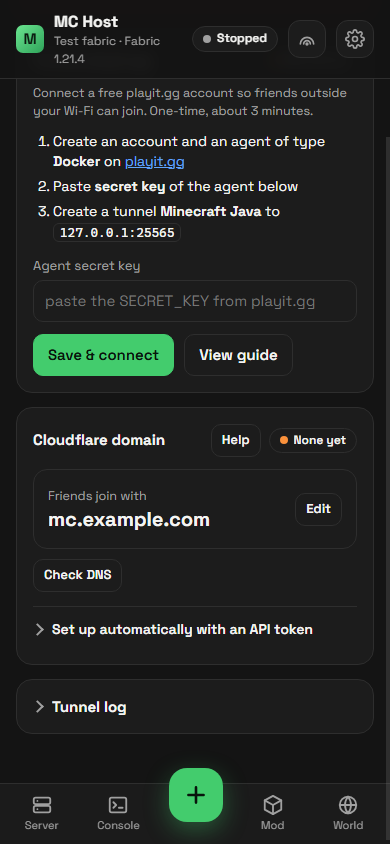

<div align="center">

<br/>


# MC Host

### Host server Minecraft Fabric langsung dari HP Android-mu!

<br/>

[](#download)
[](#fitur)
[](#cara-kerja)
[](LICENSE)

<br/>

[**Download**](#download) · [**Fitur**](#fitur) · [**Cara Pakai**](#cara-pakai) · [**Mabar Online**](#mabar-online) · [**Build**](#build) · [**FAQ**](#faq) · [**Lisensi**](#lisensi)

</div>

> [!IMPORTANT]
> MC Host **tidak berafiliasi** dengan Mojang, Microsoft, FabricMC, Modrinth, playit.gg, atau Cloudflare. Menjalankan server ini berarti kamu setuju dengan [EULA Minecraft](https://aka.ms/MinecraftEULA).

---

Bikin server Minecraft di Android biasanya ribet—harus install Termux, setup Proot, sampai ngatur Java manual. **MC Host** hadir biar kamu tinggal install satu APK, klik install Fabric, dan server siap dimainkan bareng temen-temen!

---

<div align="center">



<h1><a id="fitur"></a>Fitur Utama</h1>

<table>
  <tr>
    <td width="50%" valign="top">

#### 🚀 Core Server
- **Tinggal Install:** Nggak perlu Termux. Java 17 sudah di-bundle di dalam APK.
- **Fabric Installer:** Pilih versi Minecraft & loader, install sekali klik.
- **Manajemen Server:** Start, stop, restart, auto-restart kalau server crash.
- **Bebas Atur RAM:** Sesuaikan penggunaan RAM server dengan kapasitas HP.
- **Jalan di Background:** Dilengkapi Foreground Service, Wake Lock, & WiFi Lock biar server tetep nyala pas HP dimatikan layarnya.

#### 📦 Mod & World
- **Modrinth Store Built-in:** Cari & pasang mod langsung dari aplikasi (termasuk auto-install dependency).
- **Paket Optimasi HP:** Sekali klik buat pasang Lithium, FerriteCore, Krypton, ModernFix, & Chunky.
- **Kelola World:** Backup/restore otomatis, jelajah folder world, reset Nether/End tanpa hapus Overworld.
- **Editor Config & Properties:** Edit file `.toml`, `.json`, `.properties` langsung di app (support offline mode/crack).

    </td>
    <td width="50%" valign="top">

#### 💻 Web Panel & Konsol
- **Web Panel Port 8080:** Akses kontrol server via WebView app atau browser PC/HP di WiFi yang sama.
- **Keamanan:** Proteksi PIN biar orang lain nggak asal masuk.
- **Konsol Live:** Kirim command langsung + tombol shortcut cepat.
- **Player Management:** Atur OP, Whitelist, Gamemode, Kick, Ban, dll.
- **Monitoring HP:** Cek RAM server, baterai, suhu HP, & uptime real-time.

#### 🌐 Mabar Online (Public Access)
- **Playit.gg Integration:** Tunneling gratis bawaan app tanpa perlu ubah router/IP publik.
- **Custom Domain Cloudflare:** Auto-setup record SRV via API token Cloudflare.
- **Share Alamat Langsung:** Tinggal salin IP/domain di beranda dan kirim ke temen.

    </td>
  </tr>
</table>

<table>
  <tr>
    <td align="center"><br/><sub>Beranda</sub></td>
    <td align="center"><br/><sub>Konsol &amp; Player</sub></td>
    <td align="center"><br/><sub>Modrinth Store</sub></td>
    <td align="center"><br/><sub>Domain Cloudflare</sub></td>
  </tr>
</table>

</div>

---

<div align="center">

<h1><a id="download"></a>Download</h1>

Unduh `MCHost-1.0.x.apk` terbaru di halaman [**Releases**](../../releases/latest).

</div>

- **Install via HP:** Buka file APK & izinkan *Install unknown apps*. Kalau ada peringatan "dibuat untuk versi Android lama", abaikan saja (cek [FAQ](#faq) kenapa begitu).
- **Install via ADB (PC):** Tersedia script [`install-mchost.bat`](install-mchost.bat) untuk install otomatis via USB Debugging, atau jalankan perintah:

```bat
adb install -r MCHost-1.0.x.apk
adb shell dumpsys deviceidle whitelist +id.akhmad.mchost
